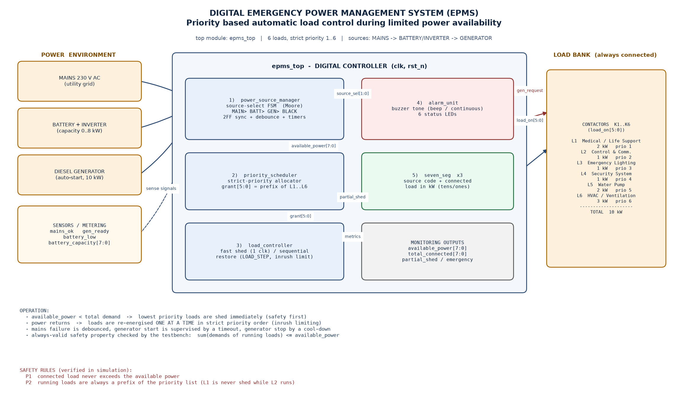
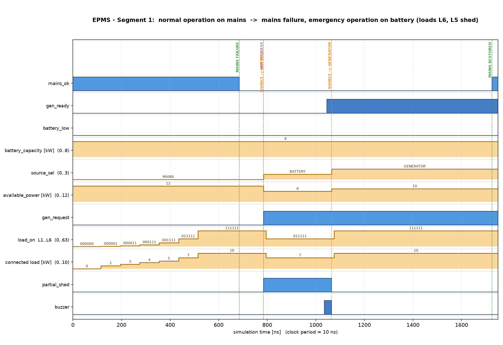
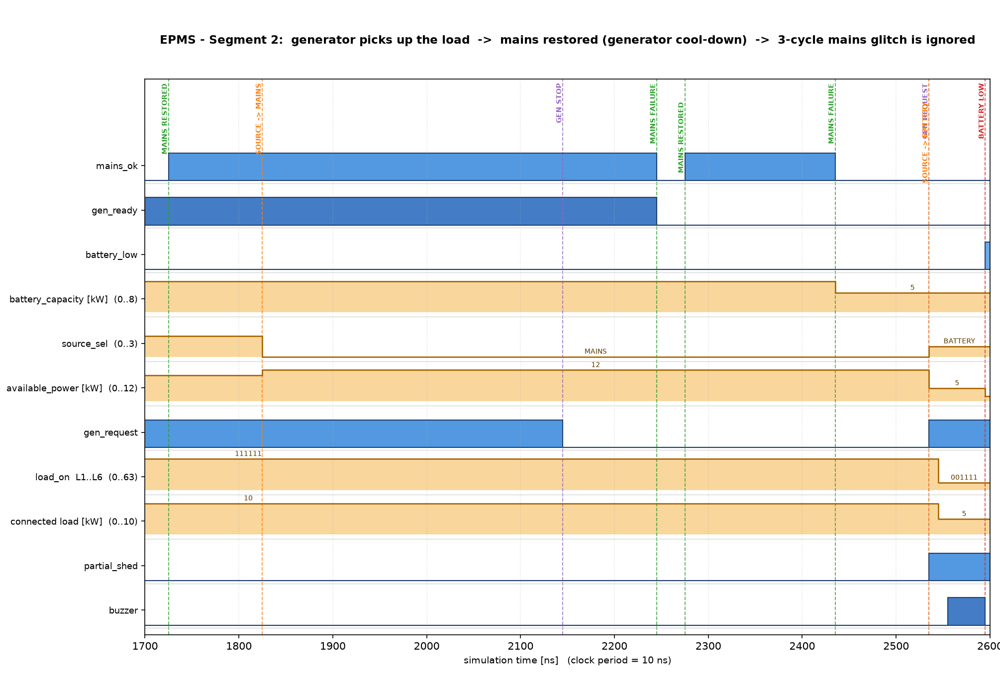
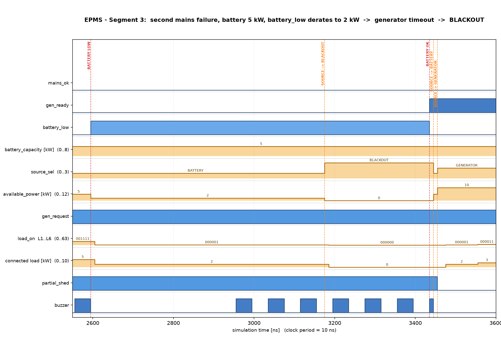
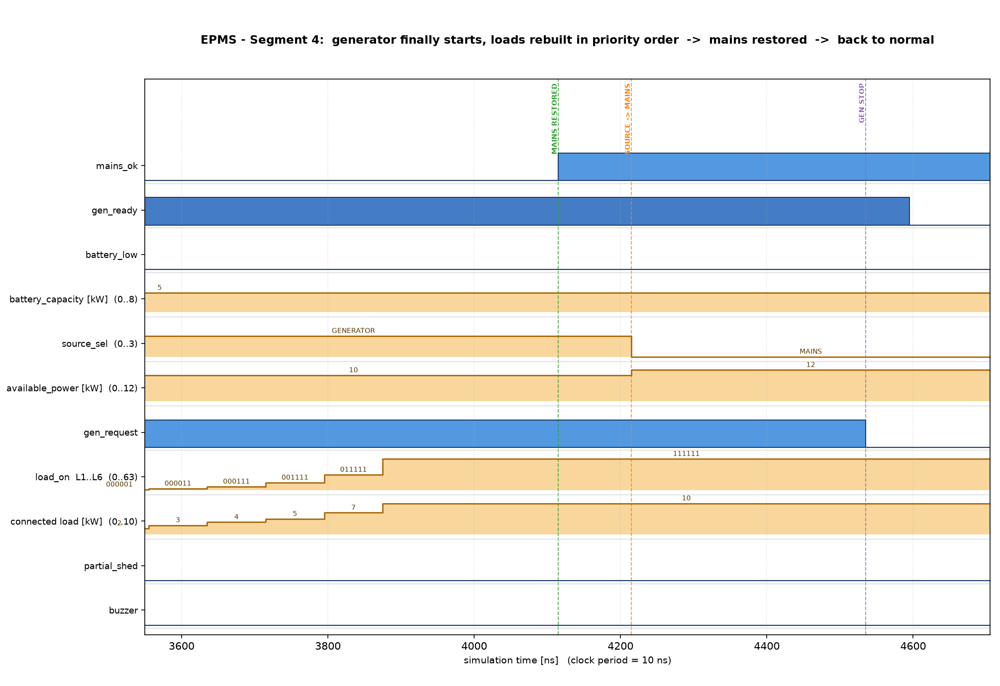
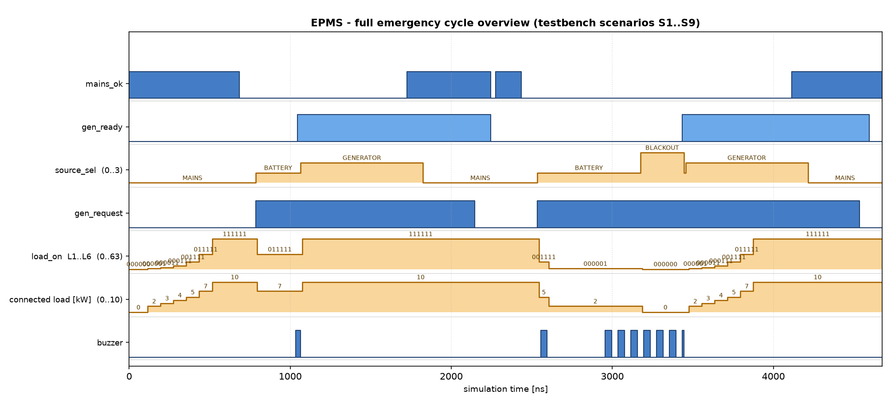

# DIGITAL EMERGENCY POWER MANAGEMENT SYSTEM (EPMS)

**Priority-Based Automatic Load Control During Limited Power Availability**

Written in Verilog HDL · Verified with Xilinx Vivado 2025.2 (xsim)

---

## 1. Problem Statement

During a power emergency a building or facility still has to keep its most
important equipment running, but the available power is **less than the total
demand**. A human operator cannot react fast or consistently enough, and
simply cutting power at random destroys priority: life-support equipment may
drop while a ventilation fan keeps running.

We need a **digital controller** that continuously compares the power
currently available from the active source against the power demanded by the
connected loads, and that:

* selects the active source automatically (mains → battery/inverter →
  generator → blackout),
* **sheds the lowest-priority loads immediately** whenever available power
  drops below demand, so the remaining load never exceeds the supply,
* **re-energises loads in strict priority order** as soon as power returns,
* warns the operator (buzzer + LEDs + 7-segment readout), and
* never allows a low-priority load to run while a higher-priority load is
  waiting for power.

The loads are **always connected** (there are no user ON/OFF switches) — the
controller alone decides which of them are allowed to draw power.

---

## 2. Objectives

1. Model the power environment (mains, battery/inverter, generator) as a
   clocked digital system with a Moore FSM for source selection.
2. Implement a **strict-priority allocator** that decides, every cycle, which
   loads may run given the available power.
3. Guarantee two safety properties at all times:
   * **P1** – the sum of the demands of the running loads is never greater
     than the available power.
   * **P2** – the running loads are always a *prefix* of the priority list
     (L1 is never shed while L2 still runs).
4. Make shedding **fast** (1 clock) and restoration **sequenced** (one load at
   a time) to model real inrush-current limiting.
5. Provide audible/visual annunciation (buzzer tone, status LEDs, 7-segment
   displays of source code and connected kW).
6. Prove the design with a **self-checking testbench** covering the complete
   emergency cycle, plus a standalone unit test for the allocator.
7. Produce fully **synthesizable, parameterised, modular** Verilog that maps
   cleanly to an FPGA.

---

## 3. System Specification

### 3.1 Load table (always connected, strict priority 1 = highest)

| Load | Function                | Demand | Priority |
|------|-------------------------|-------:|:--------:|
| L1   | Medical / Life Support  | 2 kW   | 1 (highest) |
| L2   | Control & Communication | 1 kW   | 2 |
| L3   | Emergency Lighting      | 1 kW   | 3 |
| L4   | Security System         | 1 kW   | 4 |
| L5   | Water Pump              | 2 kW   | 5 |
| L6   | HVAC / Ventilation Fan  | 3 kW   | 6 (lowest) |
|      | **TOTAL DEMAND**        | **10 kW** | |

### 3.2 Power sources

| Source            | Capacity | Behaviour |
|-------------------|---------:|-----------|
| MAINS (utility)   | 12 kW   | all loads run; input is 2-FF synchronised **and debounced** |
| BATTERY + inverter| 0…8 kW (input `battery_capacity[7:0]`) | limited power → shedding; auto-starts generator |
| DIESEL GENERATOR  | 10 kW   | exactly covers total demand; started by `gen_request`, stopped after a cool-down |
| BLACKOUT          | 0 kW    | every load shed; continuous alarm |

When `battery_low` is asserted the battery is **derated to 50 %** of its
reported capacity (deep-discharge reserve), forcing even more aggressive
shedding.

### 3.3 Controller parameters (defaults in `epms_top.v`)

| Parameter | Default | Meaning |
|-----------|--------:|---------|
| `MAINS_CAPACITY` | 12 | kW available on mains |
| `GEN_CAPACITY`   | 10 | kW available from generator |
| `MAINS_DEBOUNCE` | 8 | clocks mains must be stable before a change is accepted |
| `GEN_START_TIMEOUT` | 64 | clocks the controller waits for the generator before declaring blackout |
| `GEN_COOLDOWN`   | 32 | clocks the generator keeps running after mains returns (anti-chatter) |
| `BAT_RESUME`    | 4 | kW of battery needed to leave blackout |
| `LOAD_STEP`     | 8 | clocks between two sequential turn-ON steps (inrush limiting) |
| `TONE_HALF` / `BEEP_HALF` | 25 000 / 12 500 000 | alarm tone / beep envelope half-periods (scaled down for simulation) |

All timing parameters are expressed in **clock cycles**, so the design can be
retargeted to any clock frequency simply by changing the parameter values.

### 3.4 Interfaces

```
inputs  : clk, rst_n,
          mains_ok, gen_ready, battery_low, battery_capacity[7:0]
outputs : load_on[5:0], gen_request,
          source_sel[1:0], available_power[7:0], total_connected[7:0],
          partial_shed, emergency, energising, state_out[2:0],
          buzzer, led_mains, led_battery, led_gen, led_blackout,
          led_low_batt, led_overload,
          seg_mode[6:0], seg_tens[6:0], seg_ones[6:0]
```

Source code on the 7-segment display: **0 = MAINS, 1 = BATTERY,
2 = GENERATOR, 3 = BLACKOUT**; the other two displays show the connected load
in kW.

---

## 4. Architecture / Block Diagram



**Data flow**

```
        sensors                      epms_top                                loads
mains_ok ───────┐                                                                   ┌─ K1 L1
gen_ready ──────┤   ┌──────────────────────┐   available_power   ┌──────────┐        │
battery_low ────┼──▶│ 1 power_source_manager│───────────────────▶│2 priority │ grant  │
battery_cap ────┘   │   (source-select FSM) │                    │ scheduler │──────┐ │
                    └──────────┬───────────┘                    └────┬─────┘      │ │
                               │ source_sel                          │ partial_shed│ │
                               ▼                                     ▼             ▼ ▼
                    ┌──────────────────────┐             ┌────────────────┐   ┌──────────┐
                    │ 4 alarm_unit (buzzer │             │3 load_controller│──▶│ K2..K6   │
                    │    + 6 LEDs)         │             │ shed 1 clk /    │   │ L2..L6   │
                    └──────────────────────┘             │ restore seq.   │   └──────────┘
                    ┌──────────────────────┐             └────────────────┘
                    │ 5 seven_seg x3       │◀── source code + connected kW
                    └──────────────────────┘
```

| # | Module | Type | Responsibility |
|---|--------|------|----------------|
| 1 | `power_source_manager` | Moore FSM + timers | choose the source, compute `available_power`, drive `gen_request`, debounced & synchronised inputs |
| 2 | `priority_scheduler` | combinational | strict-priority allocation → `grant[5:0]`, `total_granted`, `partial_shed` |
| 3 | `load_controller` | sequential | execute the grant: shed in 1 clock, restore one load per `LOAD_STEP` clocks in priority order |
| 4 | `alarm_unit` | sequential + comb | buzzer tone / beep envelope, six status LEDs |
| 5 | `seven_seg` ×3 | combinational | hex→7-segment decoder for source code and connected kW |
| — | `epms_top` | structural | wires everything, packs the load demands |

### 4.1 Source-selection FSM (`power_source_manager`)

```
                 mains_ok deasserted (debounced)
      ┌────────┐ ───────────────────────────────────▶ ┌────────┐
      │ MAINS  │                                      │ BATT   │
      │ 0 kW*  │ ◀─── mains stable                    │ battery│
      │ gen=0  │      (after cool-down)               │ cap    │
      └───┬────┘                                      └┬───┬───┘
          ▲   mains restored                           │   │ gen_ready
          │                                            │   ▼
   ┌──────┴─────┐   cool_cnt = GEN_COOLDOWN-1    ┌─────┴────┐
   │ COOLDOWN   │ ◀─────────────────────────────  │ GEN      │
   │ gen keeps  │                                 │ 10 kW    │
   │ running    │ ──── (mains fails again) ─────▶ │ gen=1    │
   └────────────┘          back to BATT           └────┬─────┘
                                                       │ battery_low AND
      ┌─────────┐   gen_ready / mains / battery        │ tmo = GEN_START_TIMEOUT-1
      │ BLACKOUT│ ◀────────────────────────────────────┘
      │  0 kW   │ ──── (any source recovers) ───▶ MAINS / GEN / BATT
      └─────────┘
```

Design notes (each is a distinct, explainable concept for the viva):

* **2-FF synchronisers** on `mains_ok` and `gen_ready` – these are
  asynchronous inputs from the outside world; synchronising them prevents
  metastability.
* **Debounce** on `mains_ok` – a mains dip shorter than `MAINS_DEBOUNCE`
  clocks is ignored entirely (testbench scenario S5 proves this).
* **Generator start timeout** – if the generator has not signalled `gen_ready`
  within `GEN_START_TIMEOUT` clocks *and* the battery is low, the system
  declares a blackout instead of waiting forever.
* **Generator cool-down** – after the mains returns, the generator keeps
  running for `GEN_COOLDOWN` clocks before it is stopped; this prevents
  on/off chattering on a fluctuating mains (testbench scenario S4).
* **Moore outputs** – outputs depend only on the current state, so glitches on
  the control outputs are impossible.

### 4.2 Strict-priority allocator (`priority_scheduler`)

The allocator walks the loads in priority order and keeps a running cumulative
demand `cum`. Load *k* is granted **only if** (a) no higher-priority load was
already denied, and (b) `cum + demand_k ≤ available_power`. Because demands
are accumulated in priority order, the granted set is always a **prefix** of
the priority list — that is exactly safety property **P2**.

Worked examples (demands 2,1,1,1,2,3 kW):

| available | grant (L6..L1) | granted kW | comment |
|----------:|----------------|-----------:|---------|
| 0 kW  | `000000` | 0 | blackout – everything shed |
| 1 kW  | `000000` | 0 | L1 (2 kW) does not fit → **no** lower load may steal the power |
| 2 kW  | `000001` | 2 | only L1 (medical) |
| 5 kW  | `001111` | 5 | L1..L4 – exact fit, L5/L6 shed |
| 7 kW  | `011111` | 7 | L1..L5 |
| 10 kW | `111111` | 10 | full demand, no shedding |

The "blocked" behaviour of the 1 kW row is the single most important design
decision in the project: **a low-priority load must never run while a
high-priority load is waiting for power.**

### 4.3 Load execution (`load_controller`)

* **Shedding is immediate** – a load whose grant disappears is disconnected in
  the next clock edge (safety first).
* **Restoration is sequenced** – only one load is energised per `LOAD_STEP`
  clocks, always the highest-priority load that is granted but not yet on.
  This models inrush-current limiting of motor/transformer loads and makes the
  recovery staircase clearly visible on the waveform.
* `total_connected` is computed continuously from the demands of the loads
  that are actually running and is exported for monitoring and for the
  testbench's P1 checker.

---

## 5. Verilog Implementation

The complete, commented source is in the project (listing below). Modules are
strictly Verilog-2001, synthesizable, and use **no delays, no `initial`
blocks in RTL, and no non-synthesizable constructs** — only clocked `always`
blocks with asynchronous active-low reset and combinational `always @*` blocks.

| File | Module | LOC (approx.) |
|------|--------|--------------:|
| `rtl/power_source_manager.v` | `power_source_manager` | 210 |
| `rtl/priority_scheduler.v`   | `priority_scheduler`   | 115 |
| `rtl/load_controller.v`      | `load_controller`      | 105 |
| `rtl/alarm_unit.v`           | `alarm_unit`           | 105 |
| `rtl/seven_seg.v`            | `seven_seg`            |  45 |
| `rtl/epms_top.v`             | `epms_top`             | 195 |

*(The full source code of every module is reproduced in the report appendix —
copy each file verbatim from `rtl/`.)*

Key coding practices used:

* parameterised constants instead of hard-coded numbers;
* one clocked process per register file (no mixed blocking/non-blocking
  assignments);
* Moore-style FSM with a separate next-state block;
* synchronous design style with a single clock domain.

---

## 6. Testbench and Verification Strategy

Two testbenches were written (both in `tb/`).

### 6.1 `tb_epms_top` — system regression (self-checking)

It contains **two continuous safety checkers** that run on every clock edge
and would flag a violation anywhere in the run:

* **P1 checker** – `total_connected ≤ available_power` (the check is skipped
  only in the single cycle where the availability itself changes, because the
  controller reacts one clock later).
* **P2 checker** – `load_on[k] ⇒ load_on[k-1]` for all k (prefix property).

On top of that, **45 directed checks** with expected values are spread over
nine scenarios:

| Scenario | Stimulus | What is verified |
|----------|----------|------------------|
| S1 | reset, mains healthy | all 6 loads on, 10 kW connected, gen stopped, source = 0 |
| S2 | `mains_ok → 0` | source = BATTERY, generator auto-start requested, L6 & L5 shed (8 kW battery → 7 kW kept), overload LED on |
| S3 | `gen_ready → 1` | source = GENERATOR, all loads restored in priority order, 10 kW |
| S4 | `mains_ok → 1` | back on mains, generator runs through cool-down, then stops |
| S5 | 3-clock mains glitch | **ignored** by the debounce – no load disturbed, no generator start |
| S6 | second failure, battery 5 kW, then `battery_low` | L1..L4 kept (exact fit), then derated to 2 kW → only L1 survives |
| S7 | generator never starts | start timeout → BLACKOUT, 0 kW, every load shed, continuous tone |
| S8 | generator finally starts | all loads rebuilt in priority order |
| S9 | mains restored | back to NORMAL, generator stopped, alarm silent |

### 6.2 `tb_priority_scheduler` — unit test

Exhaustive sweep of `available_power = 0…15 kW` checking after every step:

* **U1** granted power never exceeds available power,
* **U2** the grant vector is always a priority prefix,
* **U3** increasing the available power never *disconnects* a load
  (monotonicity → no oscillation),
* **U4** four known vectors (0 / 5 / 10 / 15 kW).

52 checks, 0 errors.

### 6.3 How the verification found real bugs

The first regression **failed in 8 checks** and the unit test in 2 — and both
failures pointed at genuine design bugs, which is exactly what a testbench is
for:

1. **Scheduler hole (RTL bug).** The first allocator version tested each load
   against the *remaining* power but did not stop after a denial, so at
   1 kW availability the 2 kW medical load was denied but the 1 kW
   control-and-communication load was granted — a low-priority load stealing
   power from a waiting high-priority load (U2/U3 failures). Fixed by latching
   a `blocked` flag: once any load is denied, every lower-priority load is
   denied too.
2. **Testbench bug.** The system testbench forgot to drop `gen_ready` after
   the generator stopped, so the second mains failure immediately jumped to
   GENERATOR instead of BATTERY (S6/S7 failures). Fixed by driving the
   generator model realistically.

After both fixes: **45/45 system checks and 52/52 unit checks pass.**

---

## 7. Simulation Results

Tool: **Vivado 2025.2 xsim** (batch flow `sim/run_sim.bat`).
Simulation length 4 675 ns at a 10 ns clock (100 MHz), all checks pass:

```
 CHECKS RUN : 45
 ERRORS     : 0
 RESULT     : **** ALL TESTS PASSED ****
```

*(Full console transcript: `sim/run_system.log` and `sim/run_unit.log`.)*

### 7.1 Waveforms



**Segment 1 – normal operation and first mains failure.** The controller boots
on mains: `source_sel = MAINS`, `available_power = 12 kW`, and the loads are
energised one at a time (staircase on `load_on` / `total_connected`, reaching
10 kW). At 690 ns the mains fails; after the debounce window
`source_sel → BATTERY`, `gen_request` rises (auto-start) and loads L6 and L5
are shed within one clock — the connected load drops from 10 kW to 7 kW and
the alarm starts beeping (`buzzer`, intermittent). Note `available_power`
falls 12 → 8 kW while `partial_shed` rises.



**Segment 2 – generator takeover, mains return, glitch rejection.** When
`gen_ready` rises, `source_sel → GENERATOR`, `available_power` becomes 10 kW
and the loads are rebuilt one at a time (the visible staircase on
`load_on`: 011111 → 111111). When the mains returns, the controller goes back
to MAINS but keeps `gen_request` asserted through the cool-down window, then
stops the generator. The 3-clock mains glitch around 2435 ns is completely
ignored (compare with the debounce behaviour in Segment 1).



**Segment 3 – battery derating and blackout.** On the second failure the
battery (5 kW) carries L1..L4 exactly. When `battery_low` is asserted the
available power is derated to 2 kW → only the medical load L1 survives
(`load_on = 000001`). Because the generator never starts, the start-timeout
expires and the system enters **BLACKOUT**: `available_power = 0`,
`load_on = 000000`, and the buzzer switches from intermittent beeping to a
**continuous tone**. As soon as `gen_ready` rises, `source_sel → GENERATOR`
and the loads begin to be rebuilt.



**Segment 4 – recovery to normal.** All six loads are re-energised in strict
priority order (2 → 3 → 4 → 5 → 7 → 10 kW staircase), then the mains is
restored, the generator runs its cool-down and stops, and the system returns
to the quiet MAINS state.



**Full-cycle overview** of the complete S1…S9 regression in one picture — the
whole emergency story of the system at a glance.

### 7.2 Result summary table

| # | Check | Expected | Simulated | Result |
|---|-------|----------|-----------|:------:|
| S1 | source / loads / kW on mains | 0 / 111111 / 10 | 0 / 111111 / 10 | PASS |
| S2 | battery mode, loads kept | 1 / 011111 / 7 | 1 / 011111 / 7 | PASS |
| S3 | generator mode, all loads | 2 / 111111 / 10 | 2 / 111111 / 10 | PASS |
| S4 | cool-down then gen stop | gen_request 1→0 | 1→0 | PASS |
| S5 | 3-cycle glitch ignored | no change | no change | PASS |
| S6 | 5 kW exact fit, then derate | 001111 → 000001 | 001111 → 000001 | PASS |
| S7 | timeout → blackout | 3 / 0 kW / 000000 | 3 / 0 kW / 000000 | PASS |
| S8 | generator restart, rebuild | 2 / 111111 | 2 / 111111 | PASS |
| S9 | back to normal | 0 / gen off / silent | 0 / gen off / silent | PASS |
| P1 | connected ≤ available (every cycle) | never violated | never violated | PASS |
| P2 | priority prefix (every cycle) | never violated | never violated | PASS |

---

## 8. How to Run

**Batch (command line)**

```
cd emergency-power-management
sim\run_sim.bat          # compiles with xvlog, runs both regressions,
                         # writes sim\run_system.log, sim\run_unit.log and
                         # sim\waveforms\*.vcd
python tools\plot_waveforms.py      # regenerate the waveform PNGs
```

**Vivado GUI**

```
vivado -mode batch -source vivado\create_project.tcl
```

or in the Vivado Tcl console: `source vivado/create_project.tcl`, then
**Flow Navigator → Simulation → Run Simulation → Run Behavioral Simulation**
and add the signals of `tb_epms_top` (or `tb_epms_top.dut`) to the waveform
viewer. The testbench runs to ~4.7 µs and prints the PASS/FAIL summary in the
xsim console.

---

## 9. Conclusion

A fully working, self-checking digital emergency power management system was
designed, implemented in synthesizable Verilog-2001 and verified in Vivado
xsim:

* The **source-selection FSM** transparently walks MAINS → BATTERY →
  GENERATOR → BLACKOUT and back, with debounced inputs, a generator
  start-timeout and a cool-down anti-chatter timer.
* The **strict-priority allocator** guarantees that the running loads are
  always a prefix of the priority list and that the consumed power never
  exceeds the available power — the two properties a real emergency
  installation must never violate.
* The **load controller** sheds within one clock (safety) and restores one
  load per step (inrush limiting), making the recovery behaviour smooth and
  auditable on the waveform.
* The **annunciator** gives audible (beep / continuous) and visual (LEDs,
  7-segment source code and connected-kW) feedback.
* Verification covered the complete emergency cycle in nine scenarios plus an
  exhaustive allocator sweep — **97 checks, 0 errors** — and the process
  uncovered and fixed one genuine priority bug and one testbench bug,
  demonstrating a real verification loop.

**Possible extensions:** per-load reconnection delay, I²C/UART telemetry of the
source status, a hardware PWM buzzer output, synthesis to an Artix-7 board with
physical switches for `mains_ok` / `gen_ready`, and dynamic load-demand
measurement instead of fixed parameters.

---

## 10. Team Work Split (suggested, for the individual-contribution record)

| Member | Module(s) owned | Must be able to explain |
|--------|-----------------|-------------------------|
| A | `power_source_manager` | FSM states/transitions, debounce, synchronisers, timeout & cool-down timers |
| B | `priority_scheduler` + `tb_priority_scheduler` | strict-priority algorithm, prefix property, the blocked-flag fix, unit-test sweep |
| C | `load_controller` + `alarm_unit` + `seven_seg` | fast shed vs. sequential restore, inrush limiting, tone/beep generation, 7-segment encoding |
| D | `epms_top` + `tb_epms_top` + scripts/docs | structural wiring, parameters, all nine scenarios, the two continuous checkers, Vivado flow |

---

*Guideline compliance checklist*

| Guideline item | Where it is addressed |
|----------------|-----------------------|
| 4 – problem statement, objectives, logic design, block diagram, code, expected output | §1, §2, §3, §4, §5, §7 |
| 5 – structured, functional Verilog | `rtl/` (6 modules, Verilog-2001, synthesizable) |
| 6 – suitable testbench | §6, `tb/tb_epms_top.v`, `tb/tb_priority_scheduler.v` |
| 7 – simulation & verification | §6, §7, `sim/run_sim.bat`, `sim/run_*.log` |
| 8 – timing diagrams, waveforms, output verification | §7.1 (`docs/images/waveform_*.png`), `sim/waveforms/*.vcd` |
| 9 – documentation | this report |
| 10 – demonstration | `sim\run_sim.bat` + Vivado GUI (§8) |
| 11 – individual contribution | §10 |
| 12 – originality | all code written for this project from scratch |
